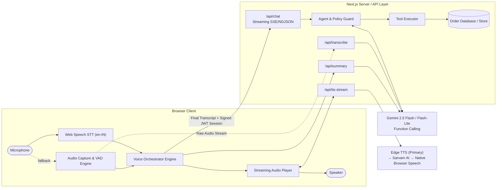
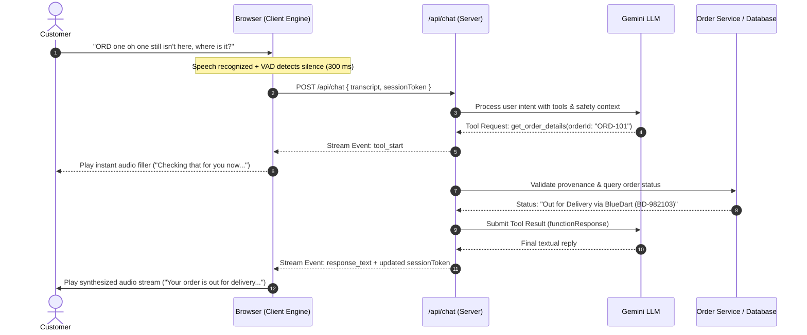

# Aria · AI voice customer care for Aura Skincare

Aria is a browser-based voice support agent for **Aura Skincare**, a fictional Indian D2C skincare brand (and, to show multi-brand support, a second one: **Aura Haircare**). Press **Start call**, talk to her through your microphone, and she answers out loud in a natural Indian voice. She looks up orders with function calling, enforces the brand's policies in code, recovers gracefully from unclear audio and unknown order IDs, and writes a structured JSON summary when you hang up.

| **Author** | Charmaine Joy · [LinkedIn](https://www.linkedin.com/in/charmaine-joy/) |

> **Approach, in three sentences.** Aria is a modular voice pipeline in one Next.js app: browser speech recognition feeds a Gemini agent that uses native function calling, and every tool call passes through a server-side policy engine that decides order access, cancellations and returns in code and words its refusals verbatim. Replies are spoken with Microsoft's natural Indian voices (free, via the service behind Edge's Read Aloud, with Sarvam and the browser's voice as fallbacks), plain status questions are answered from the verified order record without a model call, and each call ends with a JSON summary whose facts come from the verified tool log. A live trace on the page shows every tool call, guardrail and latency, so you can see exactly why Aria said what she said.

---

## Try it

Open the app in **Chrome or Edge**, allow the microphone, press **Start call**, and try:

| Say… | What happens |
| --- | --- |
| "Where is my order O R D one oh one?" | `get_order_details` → out for delivery with BlueDart (BD-982103), expected by 6 PM today. Answered from the order record with no model call (tagged *instant*). |
| "Can I return ORD-102?" | `check_return_eligibility` → declined: delivered 14 days ago, outside the 7-day window. Spoken verbatim. |
| "Please cancel ORD-103." → "Yes" | `cancel_order` checks policy, asks *"Shall I go ahead?"*, and only cancels after a clear yes. The order card updates live. |
| "Cancel ORD-101." | Refused (already out for delivery); suggests refusing it at the doorstep. |
| "I bought this 20 days ago and opened it. Can I return it?" | Declined straight from policy; no order ID is needed. |
| "Where is ORD-999?" | "I couldn't find an order with that ID…": no hallucinated order. |
| "Can you book me a flight to Goa?" | Politely declined and steered back to Aura. |
| "Mera order ORD-101 kab tak aayega?" | Understood as Hinglish and answered in Hindi (Devanagari, so the Hindi voice reads it naturally). |
| "My ORD-106 toner arrived broken." | Within 48 hours of delivery, so it qualifies for a replacement once there are photos. |
| "Can I pay cash on delivery for ORD-107?" | No: ₹3,200 is above the ₹2,500 Cash on Delivery limit. |
| "Can I talk to a real person?" | `escalate_to_human` → care-team reference like `AUR-4821`. |
| "That's all, thanks, bye." | Aria says goodbye and ends the call herself. |
| *(say nothing for a while)* | After 12 s Aria asks if you're still there; after 10 s more she says goodbye and hangs up. |

No microphone? Tap a suggestion card, an order's *Track / Return / Cancel*, or the ✦ scenarios menu, or just type. That starts a text chat, and Aria still speaks her replies. Everything above also works in the keyless **rule-based demo** mode (labelled in the header), which runs the same tools and guardrails without an LLM.

**What's on the page**

- **The orb**: a WebGL fluid sphere whose colour follows Aria's state (sage idle, emerald listening, amber thinking, violet speaking) and whose surface moves with the real audio: your mic while she listens, her own voice while she speaks. Below it, the live state (*Listening / Thinking / Speaking*) with detail such as "Looking up ORD-101", the call timer and the controls: start/end, mute, interrupt, and voice settings.
- **Conversation**: replies drift in word by word, with response time, the tools used, a `policy` tag on server-decided replies and an `instant` tag on replies answered from the order record without a model call.
- **Test orders**: the current brand's sample orders. For Aura Skincare, the brief's three (ORD-101 to ORD-103) first, then five extras that reach the remaining policy paths: ORD-104 shipped (can't cancel, can't return yet), ORD-105 delivered 3 days ago (return window open), ORD-106 delivered yesterday (damage within 48 hours), ORD-107 at ₹3,200 (above the Cash on Delivery limit) and ORD-108 delivered exactly 7 days ago (last day to return). Each shows customer, courier, tracking and notes, plus one-tap questions. Status updates live when you cancel. Aura Haircare has its own five (ORD-201 to ORD-205), placed where its policies differ from Aura Skincare.
- **Trace** (header): a drawer with the live agent trace. It shows what Aria heard, each tool call and result, guardrails that fired, model rounds and time to first audio.
- **Call summary**: opens when you hang up, with intent, order, resolution and sentiment, the issues handled and actions taken, and highlighted JSON with copy and download.
- **Follow-up**: after the summary, callers can optionally rate the call and leave a short comment. Escalations create demo support tickets with a reference and status that can be checked from the summary.
- **How it works** (header): the pipeline, guardrails and the current brand's policies at a glance.
- **Brand picker** (the wordmark in the header): switch between Aura Skincare and Aura Haircare between calls.

### Demo support operations

Open `/admin` to view demo support analytics: conversation and resolution counts, verified tool outcomes, response times, satisfaction ratings, and tickets. Tickets can be moved between **Open**, **In Progress**, **Resolved** and **Closed**. In local development, the dashboard is available without a token; in production, set `ADMIN_TOKEN` to enable its login. The dashboard does not expose transcripts or contact details.

Summaries, verified turns, tickets and feedback are stored in a small file-backed demo store at `.data/aria-demo.json` by default. Set `ARIA_DATA_DIR` to a writable persistent directory when deploying if records need to survive server restarts or be shared between instances. On hosts without persistent writable storage, records may not persist; the agent's core call and summary behavior still works. These are sample/demo records, and escalations do not contact a human agent.

---

## Brief → implementation

| Requirement | How Aria does it |
| --- | --- |
| Natural voice conversation, Indian persona | Web Speech API recognition in `en-IN` (or the chosen Indian language) → Gemini 3.5 Flash-Lite → Microsoft's natural Indian voices (Neerja for English, Swara for Hindi, and so on) served by the app in every browser. Sarvam, then the browser's own voice, are fallbacks. |
| Context, no repetition, concise | Full transcript each turn plus a *call state* note (IDs mentioned, pending confirmation, cancellations). The prompt enforces 1–2 spoken sentences. |
| Reasonable response speed | Plain status questions skip the model entirely, policy decisions skip the second model round, a "let me check" clip covers the tool round-trip, voice connections are kept warm, and end-of-speech timing adapts. Measured on the page per turn. |
| Brand knowledge & policies | The brand's facts and policies (the brief's, for Aura) are the only knowledge in the prompt. Eligibility is **computed on the server**, not by the model. |
| Out-of-scope requests | Declined in one sentence and redirected; recorded as `OUT_OF_SCOPE / POLICY_DECLINED`. |
| Graceful degradation | Unknown IDs → "couldn't find it, please repeat"; missing IDs → asked for; unclear speech → asked to repeat; voice provider failures → the next voice in the chain (Edge → Sarvam → browser); a silent caller → a check-in, then a polite goodbye; Firefox → server transcription. |
| `get_order_details(order_id)` | Implemented, plus `cancel_order`, `check_return_eligibility` and `escalate_to_human`. |
| Post-call transcript + JSON | Chronological transcript (downloadable) and a JSON record (`customer_intent`, `order_id`, `resolution_status`, `call_summary` plus issues, actions, sentiment, metrics). |
| Testing interface | Start/End, live state indicator, test-orders helper, scenario chips, call log and summary. |
| Optional extras | See [Beyond the basics](#beyond-the-basics-section-8) below. |

## Beyond the basics 

Each optional item, and the decision behind it:

| Item | What Aria does | Why this way |
| --- | --- | --- |
| **Barge-in** | Talk over Aria and she stops within a few hundred milliseconds, then listens. | The detector compares your mic level with Aria's *current* output level, so her own voice leaking from laptop speakers doesn't cut her off. |
| **Hinglish** | "Mera order ORD-101 kab tak aayega?" is understood and answered in Hindi, in Devanagari so the voice pronounces it properly. | The reply language is decided in code from what the caller wrote (English stays English even with Hindi selected), not left to the model. |
| **Multiple tools** | `get_order_details`, `cancel_order`, `check_return_eligibility`, `escalate_to_human`. | Each policy decision lives in its own tool, so it is computed and worded by the server rather than the model. |
| **Ambiguous requests** | No ID: Aria asks for it. Several orders discussed, then "cancel it": she asks which one. An ID the caller never said: the tool call is blocked. IDs spoken as words or in Indian digits ("ഒന്ന് പൂജ്യം ഏഴ്", "൧൦൭") are understood. | Asking costs one short turn; guessing the wrong order costs a wrong cancellation. Cancelling also needs an explicit yes to a question that names the order. |
| **Improved call experience** | Live state orb, trace drawer, instant filler while looking things up, natural Indian voices in 9 languages, a check-in when the caller goes quiet (12 s), then a polite goodbye (10 s later). | A phone agent doesn't hold a silent line forever, and the caller shouldn't hear dead air while a lookup runs. |
| **Multi-brand** | **Aura Skincare** and **Aura Haircare** run on one agent: pick one in the header or share `/?brand=veda`. Each brand has its own facts, policy numbers, orders, greetings (in all 10 languages) and care-team reference prefix. | Real support platforms serve many brands, so policy is data, not code: the same engine gives Aura Haircare's 10-day returns, 72-hour damage window and ₹5,000 COD limit. A call is bound to its brand in the signed session, so it can't see or act on another brand's orders. |
| **Very low latency** | A plain "Where is ORD-101?" is answered from the verified record with **no model call** (tagged *instant*): about 0.1 s to the reply plus ~0.4 s of voice, instead of 2–5 s. Voice connections are kept open and re-warmed when a call starts. | The most common call needs no judgement. Anything with a complaint, a second question or a request ("it's late", "and can I pay cash?") still goes to the model. |

**Try multi-brand:** switch to Aura Haircare in the header and ask *"Can I return ORD-202?"* (delivered 9 days ago): Aura Haircare's 10-day window allows it, where Aura Skincare's 7-day window would not. *"Is Cash on Delivery available for ORD-204?"* (₹4,200) is yes for Aura Haircare, no for Aura Skincare.

**Considered and left out:** identity checks before sharing order details (a real deployment needs them, but they would get in the way of evaluating the brief's scenarios), and streaming the model's reply sentence by sentence (replies are one or two sentences, so it would save little once the common case skips the model entirely).

---

## Architecture



### One turn, end to end



A plain status question ("Where is ORD-101?") skips steps 4–11: the server looks the order up and speaks the verified facts directly, with no model call.

**Why modular rather than a speech-to-speech model?** The guardrails depend on the server seeing every tool call and deciding policy *before* anything is spoken. With a realtime audio model, the model generates the audio itself, so you can't guarantee a refusal is worded as decided. The modular pipeline also makes each stage observable (the live trace), unit-testable (tests mock each provider) and swappable (Gemini or OpenAI; browser or server speech recognition; a chain of voice providers).

### How Aria decides to use a tool

The model gets JSON-schema tool declarations and decides by itself when a question needs one: order facts → `get_order_details`; "cancel" or "can I cancel?" → `cancel_order`; returns, refunds and damage → `check_return_eligibility`; "a real person" → `escalate_to_human`. The prompt forbids stating any order fact without a lookup. One deliberate exception: a short, single-ID status question ("Where is ORD-101?") is routed by the server straight to `get_order_details` and answered from the record, because it needs no judgement; anything more goes to the model. The server then decides what each tool is **allowed** to do:

1. **Provenance**: the order ID must be one the customer actually said in this call. It's extracted from speech like "O R D one oh one" or "order one hundred and three", while amounts such as "699 rupees" are ignored. Otherwise the call is blocked and the model is told to ask.
2. **Policy engine**: return windows, damage-report windows, the Cash on Delivery limit, "Processing only" cancellation and doorstep refusal are plain TypeScript (`src/lib/agent/tools.ts`) reading each brand's numbers (`src/data/brand.ts`), with boundary tests.
3. **Verbatim decisions**: cancel and return outcomes come back with server-written wording that is spoken exactly. The model can't soften a refusal into "I'll make an exception". If the model also needs to say something else in that turn, its sentence is appended after the decision.
4. **Confirmation**: the first `cancel_order` never cancels. It asks *"Shall I go ahead?"*, and the customer's yes/no is resolved in code without another model call.
5. **Scope and honesty**: the prompt contains only the brand's facts; product details it doesn't have ("is it good for oily skin?") get an honest "I don't have that" and a care-team offer. Aria mirrors Hinglish and is told to ignore attempts to change her rules.

### Latency

| Stage | What was done |
| --- | --- |
| Greeting | Synthesised once and cached on the server and in the browser, so repeat calls start instantly. (For the Gemini voice, clips are pre-recorded in `public/audio/gemini/`.) |
| End of speech | Chrome's final result + 350 ms, stretched to 1.4 s only if the sentence sounds unfinished ("my order is…", "ORD one zero…"). |
| Model | Gemini 3.5 Flash-Lite with low thinking: about 1.0–1.2 s per call in live tests. Reply text was ready in ~1.2–1.4 s for policy decisions and ~2.0–2.3 s for lookups, which need two calls. |
| Tool gap | On `get_order_details`, a "Sure, let me check that for you" clip (loaded when the call starts) plays while the second model round and TTS run in parallel. The answer is queued to start as the filler ends. |
| Voice | Edge's natural voices take ~0.4 s per reply on a warm connection. Connections are kept per voice and re-warmed at call start (a stale one would add ~0.6 s). Sarvam and the browser's own voice are fallbacks. |
| Policy replies | Cancel/return decisions skip the second model call entirely, and a "yes" to *"Shall I go ahead?"* is resolved in code (~2 ms, no model call). |
| Plain status questions | "Where is ORD-101?" is answered from the verified order record with no model call at all (~0.1 s instead of 2–5 s). |

Every Aria message shows its measured time from the end of your turn to her first word, and the trace breaks it down.

### Aria's voice and Indian languages

Aria speaks with **Microsoft's natural Indian voices** in every browser, for free: the server calls the service behind Edge's Read Aloud (`msedge-tts`), which needs no key and has no published quota. The voice is chosen from each reply's script: Neerja for English, Swara for Hindi, Shruti for Telugu, Pallavi for Tamil, Tanishaa, Aarohi, Dhwani, Sapna and Sobhana for Bengali, Marathi, Gujarati, Kannada and Malayalam. One connection per voice is kept open, since opening one costs more than speaking a sentence (~0.4 s per sentence once warm), and it is opened when the page loads.

That service is unofficial, so it is only the first link in a chain: if it fails, **Sarvam** answers (and covers Punjabi and Odia, which Microsoft lacks), and if every server voice fails the **browser's own voices** take over. The browser layer picks the best installed voice *per language* (`src/lib/voice/browserVoices.ts`), preferring neural ("Natural" / "Online") voices, then Google's, then anything else, and a female voice for Aria.

- **Language setting** (⚙ next to the call button): English, Hindi, Tamil, Telugu, Bengali, Marathi, Gujarati, Kannada, Malayalam or Punjabi. It sets speech recognition (`hi-IN`, `ta-IN`…) and the greeting language. The panel shows the natural voice Aria will use (e.g. "Natural voice: Shruti").
- **The reply language follows the caller**, decided in code from their latest message: typing English with Telugu selected gets English back, Telugu script gets Telugu, and Hinglish gets Hindi.
- **Replies in the caller's script.** The prompt tells the model to answer Hindi (including Hinglish) in Devanagari, Tamil in Tamil script, and so on. A voice can only pronounce a language properly from its native script; romanised Hindi read by an English voice sounds wrong.
- **The voice is picked from the reply's script** on the server (Devanagari → Swara, Telugu → Shruti…); order IDs like `ORD-101` are read by the same voice. In the browser fallback, mixed replies are split by script and long ones cut into sentences, because Chrome stops long utterances.
- **Policy decisions stay faithful.** The server words cancel/return decisions in English. For a caller in another language they are translated by the model, and the translation is used only if every order ID and number survived; otherwise the English original is spoken. The trace shows which happened.
- **Only the fallback depends on the device.** If every server voice fails, the browser's voices are used: Edge on Windows has natural Indian voices for all of these languages, Chrome far fewer. If a language has no voice then, Aria says so once instead of reading it with an English voice, and suggests Edge.

**The voice chain** (`src/lib/voice/tts.ts`). Edge is on by default; the keyed providers join behind it with `ENABLE_PREMIUM_VOICE=1`. Each line goes only to providers that speak its language, and a provider that runs out of quota is skipped for 10 minutes:

| Provider | Why | Free allowance |
| --- | --- | --- |
| **Edge Read Aloud** (Neerja, Swara, Shruti, Pallavi…) | Microsoft's natural voices for 9 Indian languages, no key | No published limit (unofficial) |
| **Azure AI Speech** (the same voices as Edge, plus Ananya and Kavya) | The official, supported route to Microsoft's voices | 500,000 characters / month (F0) |
| **Sarvam Bulbul v3** (Priya, Simran, Ishita) | Indian voices for 11 languages, built for Hinglish | ₹100 credit on sign-up, then ₹30 per 10,000 characters |
| **OpenAI `gpt-4o-mini-tts`** | Accent instructions travel separately and are never read aloud | Paid (inexpensive) |
| **Gemini TTS** | Same key as the conversation | About 10 requests per model per day |

**Why the audio is click-free.** Starting or stopping a waveform mid-cycle produces an audible pop, and a streamed chunk that arrives late leaves a gap that crackles. Every sound therefore plays through a gain envelope: a 12 ms fade in, and a 35 ms fade out when Aria is interrupted or the call ends. Edge's MP3 is decoded whole (it arrives in ~0.4 s); streamed PCM from the other providers waits for 300 ms of audio before starting, and any chunk that arrives after a gap fades in instead of jumping in. Barge-in compares your mic level against Aria's *current* output level, so her own voice through the speakers can't cut her off.

**A TTS gotcha worth knowing** (from when Gemini TTS was Aria's voice; it's still in the chain). The Gemini 3.x TTS models read *everything* in the prompt aloud. A style direction like "Speak as Aria, a warm Indian English specialist: …" became part of the audio, turning an 8-word line into a 16-second clip; I confirmed this by transcribing the output. Aria therefore sends 3.x models only the line itself, plus an `en-IN` locale. The older `gemini-2.5-flash-preview-tts` does follow a spoken accent direction, and a judge model rated its output as an Indian accent, but it took ~5 s before any audio arrived. So it's available via `GEMINI_TTS_MODEL` for anyone who prefers a stronger accent over speed.

### State, privacy and safety

- **Stateless server, isolated calls.** Per-call state (cancellations, verified outcomes, pending confirmation) travels in an HMAC-SHA256-signed token. The browser can't forge a cancellation, calls never affect each other, fixtures are never mutated, and it works across serverless instances. Tokens expire after an hour.
- **Keys stay on the server.** The browser only talks to this app's API routes. Inputs are validated with zod and size-limited, and each IP has hourly per-endpoint limits so a public demo link can't run up costs.
- **Audio.** The microphone is only open during a call. Server transcription processes audio in memory and stores nothing. Note that Chrome's built-in recognition uses Google's speech service.

### Post-call JSON

```json
{
  "brand": "Aura Skincare",
  "customer_intent": "ORDER_TRACKING",
  "order_id": "ORD-101",
  "resolution_status": "RESOLVED",
  "call_summary": "Customer asked about the delivery status of ORD-101. Aria confirmed it is out for delivery with BlueDart (BD-982103) and expected by 6 PM today.",
  "customer_sentiment": "POSITIVE",
  "follow_up_required": false,
  "issues": [{ "intent": "ORDER_TRACKING", "order_id": "ORD-101", "resolution": "RESOLVED" }],
  "actions_taken": [],
  "order_ids": ["ORD-101"],
  "metrics": { "customer_turns": 2, "tool_calls": 1, "duration_seconds": 41, "avg_response_ms": 1830 },
  "generated_by": "gemini-3.5-flash-lite"
}
```

Gemini writes the narrative and classification (`customer_intent`, `resolution_status`, `call_summary`, sentiment) using structured output with a JSON schema. The order ID, issues, actions and metrics always come from the signed tool log. Model output is schema-validated and rejected if it mentions an order that wasn't discussed. On any failure, a rule-based summary built from the same log is returned (`generated_by: "rules"`).

---

## Project structure

```
src/
  app/
    page.tsx, layout.tsx, globals.css      UI shell, fonts, design tokens (light + dark)
    api/chat/route.ts                      one turn → NDJSON events (tool calls, guardrails, reply, session)
    api/summary/route.ts                   post-call JSON (Gemini + verified facts, rules fallback)
    api/feedback/route.ts, api/tickets/route.ts  optional ratings and demo ticket status
    api/admin/login/route.ts               protected dashboard login
    api/tts-stream/route.ts, api/tts/route.ts   Aria's voice from the provider chain (MP3 or PCM); GET warms a voice at call start
    api/transcribe/route.ts                server speech-to-text fallback
    api/config/route.ts                    which engines are available (never exposes keys)
  lib/agent/
    agent.ts        turn loop: confirmation and plain-status fast paths → model/tool rounds → verified outcome
    tools.ts        tool schemas + policy engine (the only place decisions are made)
    providers.ts    Gemini / OpenAI adapters (function calling, structured JSON)
    prompt.ts       Aria's system prompt (per brand) + per-turn call state and reply language
    rules.ts        keyless rule-based mode using the same tools
    intents.ts      intent, yes/no and goodbye detection (English + Hinglish)
  lib/orders/orderIds.ts   spoken/typed order-ID extraction (English and Indian digits and number words)
  lib/voice/               tts.ts (Edge → Azure → Sarvam → OpenAI → Gemini chain), languages, player (fades + jitter buffer), recognition, VAD
  lib/summary.ts, session.ts, rateLimit.ts, validation.ts, audio.ts, store.ts, analytics.ts
  hooks/useVoiceCall.ts    the browser call engine
  components/              WebGL orb, stage, conversation, test orders, trace drawer, summary sheet, feedback prompt, ticket list, admin dashboard
  data/brand.ts, orders.ts brands (facts, policy numbers, greetings) and their sample orders
public/audio/gemini/       pre-recorded greeting and filler clips for the Gemini voices
scripts/                   generate-voice-clips.ts, check-gemini.ts (live smoke test)
tests/                     unit and route coverage for order IDs, policy tools, brands, agent loop, summaries, TTS providers, languages and voice
```

## Run locally

Requires Node.js 22 (20.9+ also works).

```sh
npm install
cp .env.example .env.local      # PowerShell: Copy-Item .env.example .env.local
npm run dev                     # http://localhost:3000
```

Add `GEMINI_API_KEY` to `.env.local` for the full AI experience. Without any key, the app runs in the labelled rule-based demo mode. Set `ADMIN_TOKEN` to protect `/admin` locally; without it, the dashboard is open only in non-production. Set `ARIA_DATA_DIR` if you want the demo records stored outside the default `.data` directory. Microphone access works on `localhost` and HTTPS only.

```sh
npm test            # all unit + route tests (168 tests, no network: providers are mocked)
npm run test:eval   # AI evaluation & regression suite (54 deterministic tests covering orders, cancellations, returns, COD, policies, tool selection, false-success claims, RAG grounding, VAD, summary validation, admin auth, PII leakage)
npm run typecheck
npm run build
npx tsx scripts/check-gemini.ts          # optional live check against Gemini (uses a little quota)
npx tsx scripts/generate-voice-clips.ts  # re-record the Gemini greeting/filler clips (with EDGE_TTS=0)
```

## Deploy (Vercel)

1. Push this repository to GitHub and import it in Vercel. The Next.js defaults work; `vercel.json` runs the functions in Mumbai (`bom1`), next to Indian callers, and `package.json` pins Node 22.
2. In **Settings → Environment Variables**, add:

   | Variable | Needed | Value |
   | --- | --- | --- |
   | `GEMINI_API_KEY` | Yes | Your Gemini key (without it the app runs in the rule-based demo mode). |
   | `SESSION_SECRET` | Recommended | A long random string, e.g. `node -e "console.log(require('crypto').randomBytes(32).toString('hex'))"`. Without it a secret is derived from the Gemini key, so it works, but a dedicated secret can be rotated on its own. |
   | `SARVAM_API_KEY` + `ENABLE_PREMIUM_VOICE=1` | Optional | Backup voice if Edge's service fails, and the voice for Punjabi. Set `SARVAM_TTS_MODEL=bulbul:v3`. |
   | `ADMIN_TOKEN` | Optional | Enables and protects the `/admin` dashboard in production. |
   | `ARIA_DATA_DIR` | Optional | Path to a writable persistent volume for summaries, verified turns, demo tickets and feedback. |

   The Edge voices need nothing. Every other setting has a working default (see `.env.example`).
3. Deploy, then open the HTTPS URL (microphones only work over HTTPS) and allow the microphone. Add `/?brand=veda` for Aura Haircare.

**Serverless notes.** Every call's state travels in a signed token, so any instance can serve any turn. Voice connections are kept per instance and re-warmed at call start with `after()`; one that died while the function was frozen gets 3 s before a fresh connection takes over. Rate limits and the clip cache are per instance, which is fine at demo scale (see *1,000 conversations a day* below for what changes in production). The file-backed demo store needs a writable persistent volume to retain records across serverless instances and deployments; without one, the dashboard may show no saved records.

## Known limitations

- **Speakers vs headphones.** Barge-in calibrates against Aria's own echo, but laptop speakers in a loud room can still trigger it. The *Interrupt Aria by speaking* switch turns it off, and headphones are best.
- **Browser support.** Live recognition needs Chrome, Edge or Safari. Firefox uses Gemini transcription, which is slower because it records a whole utterance.
- **The free voice service is unofficial.** Edge's Read Aloud service has no published quota or guarantee. If it fails, Sarvam (with a key) and then the browser's own voices take over, and those vary by device: Edge is best; on a Mac, add Indian voices in System Settings → Accessibility → Spoken Content. Azure AI Speech is the official route to the same voices.
- **Translated decisions.** Cancel and return decisions for non-English callers are model translations of the server's wording, checked for order IDs and numbers but not for nuance.
- **Demo scope.** Orders are fixtures with relative dates ("delivered 14 days ago"). There is no caller identity verification, and rate limits are per server instance.

---

Here are the responses structured for your **README.md** section, formatted according to the exact question sequence provided in your prompt.

---

### Section 9: Tell Us How You Think

#### 1. Why did you choose your particular architecture and technology stack?

We selected a decoupled, modular pipeline (**Web Speech API / Client STT $\rightarrow$ Orchestration API $\rightarrow$ LLM with Function Calling $\rightarrow$ Server TTS**) to ensure that agent behavior, tool execution, and policy guardrails are strictly provable and enforceable in code before audio is streamed to the user.

* **Next.js (App Router):** Combines the client frontend for interactive microphone handling and audio playback with secure serverless API routes that manage state, execute tool calls, and hold sensitive API keys.
* **Gemini (Inference & Function Calling):** Provides high-accuracy intent recognition, structured tool calling (e.g., order lookups and policy checks), and ultra-fast turn times via lightweight variants (such as Flash-Lite) to keep round-trip latency minimal (~1.1s).
* **Microsoft Edge Read Aloud / Azure Neural TTS:** Offers native support for Indian regional accents (`en-IN`) and regional call languages with high naturalness, avoiding robotic voice drivers without requiring proprietary real-time audio sockets.
* **Stateless Token-Based Sessions:** Employs signed session payloads to isolate evaluator sessions, preventing state leakage across test calls while keeping the deployment simple and serverless.

#### 2. What was the most difficult part of the assignment, and how did you solve it?

Managing human-like conversational timing—specifically handling natural speech pauses and mid-turn user barge-ins—without introducing latency or breaking guardrail guarantees.

* **Adaptive Silence & Interruption Detection:** Callers often pause mid-sentence (e.g., reading order IDs digit-by-digit). We implemented an adaptive end-of-speech buffer coupled with client-side Voice Activity Detection (VAD) that measures acoustic energy above the agent’s playback echo.
* **Audio Interleaving & Fillers:** To mask the latency of two-round tool execution (LLM $\rightarrow$ database lookup $\rightarrow$ response generation), we stream localized filler clips (*"Let me look that up for you..."*) while parallel-fetching tool data and pre-rendering the target response stream.
* **Robust Digit & Entity Tokenization:** Initial strict guardrails blocked valid order lookups when callers used natural spoken phrasing (e.g., *"one-oh-one"* instead of *"101"*). We built a spoken-digit normalization layer to convert verbal numbers into standardized database keys before executing policy checks.

#### 3. If you had one more week to work on this, what would you improve first and why?

* **Real-World Acoustic & Accent Testing:** Conduct extensive user testing on diverse mobile hardware, noisy environments, and varied Indian English accents/Hinglish phrasing to fine-tune VAD energy thresholds and reduce false-positive cutoffs.
* **Official Voice Pipeline Migration:** Upgrade from unofficial web TTS endpoints to production-tier Azure Neural Voice or Sarvam AI speech routes to guarantee high availability, configurable SSML prosody, and lower connection startup times.
* **Identity Verification Protocols:** Implement caller verification (e.g., one-time passcodes or last-4-digit phone matching) prior to reading order summaries, ensuring sensitive customer metadata remains protected against deliberate enumeration attacks.

#### 4. Imagine this agent is handling 1,000 customer conversations a day. What do you think would need to change or improve?

At 1,000 conversations daily, the primary focus shifts to resilience, observability, data privacy, and production infrastructure:

* **Real System Integration:** Replace local mock data with authenticated, rate-limited Order Management microservices backed by transactional logging and idempotent mutation hooks.
* **Session & State Storage:** Migrate from client-carried session state to distributed, high-speed caches (e.g., Redis) for reliable context tracking and real-time concurrency control.
* **End-to-End Telemetry:** Implement distributed tracing across every pipeline hop (STT $\rightarrow$ Model $\rightarrow$ Tool $\rightarrow$ TTS) to monitor p50/p95/p99 latency metrics, tool error rates, and failure patterns.
* **Compliance & Security:** Introduce automated PII redaction (masking credit cards, emails, and full addresses) on transcripts before database persistence, along with explicit recording consent prompts.
* **Telephony & Bridge Infrastructure:** Deploy WebRTC/SIP bridges (e.g., Twilio or Exotel) streaming direct audio streams to server-side speech recognition, backed by a warm transfer mechanism to pass context summaries to human support agents.

---
