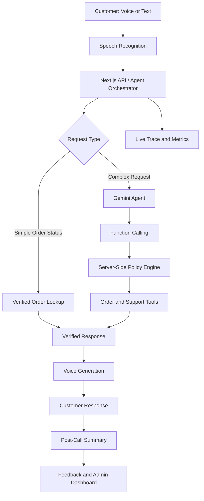

# Aria — AI Voice Customer Care for Aura Skincare

**Aria** is a browser-based AI voice customer-care agent built for Aura Skincare, a fictional Indian direct-to-consumer (D2C) skincare brand. It also supports Aura Haircare to demonstrate multi-brand customer support with different policies.

Users can speak to Aria through their microphone or use text chat. Aria looks up orders, checks policy eligibility, handles cancellation confirmations, escalates requests to demo support tickets, and generates structured post-call summaries.

**Live Demo:** https://auraskincare-cyan.vercel.app/  
**Author:** Charmaine Joy  
**LinkedIn:** https://www.linkedin.com/in/charmaine-joy/  
**GitHub:** https://github.com/Charmaine145/aura-skincare

---

## Table of Contents

- [Overview](#overview)
- [Key Features](#key-features)
- [Try the Demo](#try-the-demo)
- [Architecture](#architecture)
- [Policy Enforcement](#policy-enforcement)
- [Voice and Language Support](#voice-and-language-support)
- [Call Summary and Feedback](#call-summary-and-feedback)
- [Admin Dashboard](#admin-dashboard)
- [Technology Stack](#technology-stack)
- [Project Structure](#project-structure)
- [Getting Started](#getting-started)
- [Environment Variables](#environment-variables)
- [Testing](#testing)
- [Deployment on Vercel](#deployment-on-vercel)
- [Privacy and Security](#privacy-and-security)
- [Known Limitations](#known-limitations)
- [Tell Us How You Think](#tell-us-how-you-think)

## Overview

Traditional customer-support chatbots often struggle with natural conversations, ambiguous requests, policy enforcement, and response latency.

Aria addresses these challenges through a modular voice-agent architecture. Browser speech recognition captures the caller's input, an AI agent interprets requests and invokes tools, and a server-side policy engine validates sensitive actions before their outcomes are communicated.

The application also provides a live agent trace, sample orders, a post-call summary, and a demo support dashboard for evaluating customer interactions.

## Key Features

### 1. Natural Voice Conversations

- Browser-based microphone input and spoken responses.
- Real-time conversation states: Listening, Thinking, and Speaking.
- Start/end call, mute, interruption, and voice settings.
- Text chat and suggested scenarios when microphone access is unavailable.
- Adaptive end-of-speech handling and silence detection.
- Filler audio during longer order lookups.

### 2. AI-Powered Customer Support

Aria supports the following operations through dedicated tools:

| Tool | Purpose |
|---|---|
| `get_order_details` | Retrieve verified order information and delivery status. |
| `cancel_order` | Check cancellation eligibility and require confirmation before cancellation. |
| `check_return_eligibility` | Evaluate return, refund, and damaged-item requests against policy. |
| `escalate_to_human` | Create a demo support ticket with a reference number. |

The agent uses structured tool calling when AI mode is configured. A rule-based demo mode provides a fallback when AI credentials are unavailable.

### 3. Server-Side Policy Enforcement

Business rules are evaluated in application code rather than being left entirely to the language model.

- Cancellation eligibility depends on the order's status.
- Cancellation requires explicit customer confirmation.
- Return eligibility is determined using the applicable brand policy.
- Cash on Delivery eligibility is checked against the brand's order-value limit.
- Damaged-product claims are checked against the damage-report window.
- Unknown or unmentioned order IDs are not treated as verified records.
- Policy refusals use server-defined wording to reduce the risk of incorrect promises.

### 4. Multi-Brand Support

The application supports two fictional brands with independently configured policies.

**Aura Skincare**
- Seven-day return window.
- Forty-eight-hour damage-report window.
- ₹2,500 Cash on Delivery limit.

**Aura Haircare**
- Ten-day return window.
- Seventy-two-hour damage-report window.
- ₹5,000 Cash on Delivery limit.

Brand selection is available in the interface. The application also supports the Aura Haircare URL:

`/?brand=veda`

### 5. Live Agent Trace

The trace panel helps developers understand how the agent processes each turn.

It is designed to show:
- Recognized customer input.
- Tool calls and their results.
- Policy checks and guardrail decisions.
- Model execution rounds.
- Response latency and time to first audio.

This makes the system easier to debug, evaluate, and demonstrate.

### 6. Post-Call Summary

After a call ends, Aria produces a structured summary containing fields such as:

- Customer intent.
- Associated order IDs.
- Resolution status.
- Call summary.
- Customer sentiment.
- Issues handled.
- Actions taken.
- Conversation metrics.
- Follow-up requirements.

The application is designed to keep verified order facts and recorded actions grounded in the tool log, while generated narrative fields are validated against the expected schema.

The summary can be viewed as JSON and copied or downloaded.

### 7. Demo Support Operations

The `/admin` dashboard provides support-operation views for demo data, including:

- Conversation and resolution counts.
- Verified tool outcomes.
- Response-time metrics.
- Customer satisfaction ratings.
- Demo support tickets.
- Ticket status management.

Tickets can be moved through Open, In Progress, Resolved, and Closed.

### 8. Customer Feedback

After a call, customers can optionally submit a star rating and a short comment.

Feedback persistence depends on the configured backend storage and successful submission to the feedback API. A successful UI interaction alone should not be considered proof that a rating has been saved.

### 9. Evaluation and Regression Testing

The project includes automated testing for key customer-support scenarios, including order lookups, policy checks, cancellation confirmation, return eligibility, invalid orders, tool validation, summary validation, and other agent behaviors.

See the [Testing](#testing) section for commands and the configured test suites.

---

## Try the Demo

Open the [live application](https://auraskincare-cyan.vercel.app/) in Chrome or Edge.

1. Allow microphone access if prompted.
2. Press **Start Call**.
3. Ask a customer-support question.
4. Observe Aria's response and the live agent trace.
5. End the call to view the summary and feedback options.

If you cannot use a microphone, try the suggested questions, order action buttons, or text-chat interface.

### Example Scenarios

| Customer request | Expected behavior |
|---|---|
| “Where is my order ORD-101?” | Retrieve the order's delivery status. |
| “Can I return ORD-102?” | Reject the return if the order is outside the applicable window. |
| “Please cancel ORD-103.” | Check eligibility and request explicit confirmation. |
| “Cancel ORD-101.” | Refuse cancellation if the order is already out for delivery. |
| “Where is ORD-999?” | Explain that the order could not be found. |
| “My ORD-106 toner arrived broken.” | Check the damage-report window and explain the evidence requirements. |
| “Can I pay cash on delivery for ORD-107?” | Apply the Aura Skincare COD limit. |
| “Can I talk to a real person?” | Create a demo escalation ticket and provide its reference. |
| “Mera order ORD-101 kab tak aayega?” | Interpret Hinglish and respond in the appropriate language when supported. |
| “Can you book me a flight to Goa?” | Decline the unrelated request and redirect to customer support. |

These are intended demo scenarios. Their actual behavior should be verified against the deployed version before being presented as confirmed results.

---

## Architecture

Aria uses a modular pipeline inside a Next.js application.

### High-Level Flow



### Why a Modular Architecture?

The agent, tools, policies, speech recognition, and speech synthesis are separate components. This allows individual stages to be tested and changed without rewriting the entire application.

The server remains responsible for validating tool inputs, applying business rules, and recording verified actions. The model assists with interpreting requests and generating conversational responses but does not independently authorize sensitive transactions.

Simple order-status questions can use a direct lookup path to avoid unnecessary model latency.

## Policy Enforcement

The server-side policy engine is responsible for business decisions.

### Cancellation Flow

1. Identify the requested order.
2. Retrieve the verified order record.
3. Check whether its status permits cancellation.
4. Ask the customer for confirmation.
5. Resolve the confirmation explicitly.
6. Update the demo order state only after the required checks pass.

### Return and Damage Flow

1. Identify the relevant order when available.
2. Retrieve its delivery information.
3. Evaluate the applicable time window.
4. Apply the selected brand's policy.
5. Communicate the result without inventing an exception.

### Unknown Orders and Ambiguous Requests

If an order ID cannot be found or was not actually provided by the caller, the agent should ask for clarification instead of guessing. If multiple orders are under discussion, the agent should clarify which order the customer means before acting.

---

## Voice and Language Support

The application is designed to support natural Indian English and multiple Indian languages.

Configured language options include:

- English
- Hindi
- Tamil
- Telugu
- Bengali
- Marathi
- Gujarati
- Kannada
- Malayalam
- Punjabi

The implementation uses browser speech recognition where supported and a configurable server-side speech-to-text fallback. Text-to-speech can use Microsoft Edge Read Aloud-compatible voices, with optional alternative providers and browser voices.

The intended voice fallback sequence prioritizes the configured provider and moves to available alternatives when a provider fails.

**Important:** Availability, accent quality, quotas, latency, and browser compatibility depend on the provider and deployment environment. The Edge Read Aloud-compatible service is unofficial; Azure AI Speech is the supported Microsoft alternative.

---

## Call Summary and Feedback

The summary separates generated narrative fields from verified facts.

Example summary structure:

```json
{
  "brand": "Aura Skincare",
  "customer_intent": "ORDER_TRACKING",
  "order_id": "ORD-101",
  "resolution_status": "RESOLVED",
  "call_summary": "The customer asked about the delivery status of ORD-101.",
  "customer_sentiment": "POSITIVE",
  "follow_up_required": false,
  "issues": [
    {
      "intent": "ORDER_TRACKING",
      "order_id": "ORD-101",
      "resolution": "RESOLVED"
    }
  ],
  "actions_taken": [],
  "order_ids": ["ORD-101"],
  "metrics": {
    "customer_turns": 2,
    "tool_calls": 1,
    "duration_seconds": 41,
    "avg_response_ms": 1830
  },
  "generated_by": "gemini-3.5-flash-lite"
}
```

The values above are illustrative. Actual output should reflect the conversation and verified tool results.

Customer feedback is optional. A production implementation should confirm server acceptance, persist the rating and comment, and handle failed submissions visibly.

---

## Admin Dashboard

Open:

`https://auraskincare-cyan.vercel.app/admin`

The dashboard is intended for viewing aggregate support analytics, customer satisfaction feedback, and demo ticket statuses.

Configure `ADMIN_TOKEN` for protected production access.

The dashboard is a demonstration of support operations, not a live customer-service platform. Escalations create demo tickets and do not contact an actual human support representative.

---

## Technology Stack

| Technology | Purpose |
|---|---|
| Next.js | Application framework and API routes |
| React and TypeScript | Frontend components and typed application logic |
| Gemini | AI responses, tool selection, and structured summaries |
| Web Speech API | Browser speech recognition where supported |
| Edge-compatible TTS / optional providers | Speech synthesis |
| Zod | Input validation and schema checks |
| HMAC-SHA256 | Signed session-state integrity |
| File-backed JSON store | Demo persistence |
| Node.js | Runtime and development tooling |
| Vercel | Hosting and deployment |
| Automated tests | Regression and policy validation |

---

## Project Structure

```text
src/
├── app/
│   ├── page.tsx
│   ├── layout.tsx
│   ├── globals.css
│   └── api/
│       ├── chat/route.ts
│       ├── summary/route.ts
│       ├── feedback/route.ts
│       ├── tickets/route.ts
│       ├── admin/login/route.ts
│       ├── tts/route.ts
│       ├── tts-stream/route.ts
│       ├── transcribe/route.ts
│       └── config/route.ts
├── components/
├── data/
│   ├── brand.ts
│   └── orders.ts
├── hooks/
│   └── useVoiceCall.ts
└── lib/
    ├── agent/
    │   ├── agent.ts
    │   ├── tools.ts
    │   ├── providers.ts
    │   ├── prompt.ts
    │   ├── rules.ts
    │   └── intents.ts
    ├── orders/
    ├── voice/
    ├── summary.ts
    ├── session.ts
    ├── rateLimit.ts
    ├── validation.ts
    ├── audio.ts
    ├── store.ts
    └── analytics.ts

public/
scripts/
tests/
```

This is a reference layout based on the intended implementation. Confirm file names against the current repository before relying on this tree as an exact inventory.

---

## Getting Started

### Prerequisites

- Node.js 22 recommended; Node.js 20.9 or newer may work.
- npm.
- Chrome or Edge recommended for voice testing.
- A Gemini API key for the full AI experience.

### Installation

Clone the repository:

```bash
git clone https://github.com/Charmaine145/aura-skincare.git
cd aura-skincare
```

Install dependencies:

```bash
npm install
```

Create the local environment file:

**Windows PowerShell**

```powershell
Copy-Item .env.example .env.local
```

**macOS / Linux**

```bash
cp .env.example .env.local
```

Add your environment variables, then start the development server:

```bash
npm run dev
```

Open http://localhost:3000.

Without an AI key, the application is intended to run in a clearly labelled rule-based demo mode, provided the relevant fallback is enabled in the implementation.

---

## Environment Variables

Configure these in `.env.local` for development and in Vercel for deployment.

| Variable | Purpose |
|---|---|
| `GEMINI_API_KEY` | Enables Gemini-powered conversation and structured summaries. |
| `GEMINI_MODEL` | Selects the primary Gemini model. |
| `GEMINI_FALLBACK_MODEL` | Optional fallback model. |
| `SESSION_SECRET` | Dedicated secret for signing session state. |
| `SARVAM_API_KEY` | Optional Sarvam speech-provider credentials. |
| `ENABLE_PREMIUM_VOICE` | Enables optional premium voice providers when configured. |
| `SARVAM_TTS_MODEL` | Configures the Sarvam speech model. |
| `ADMIN_TOKEN` | Protects the production admin dashboard. |
| `ARIA_DATA_DIR` | Optional directory for demo data when writable persistent storage is available. |

Example:

```dotenv
GEMINI_API_KEY=your_gemini_api_key
GEMINI_MODEL=your_supported_gemini_model
SESSION_SECRET=your_long_random_secret
ADMIN_TOKEN=your_admin_token
ARIA_DATA_DIR=.data
```

Use the model identifiers supported by your provider and the current application configuration. Never commit `.env.local` or publish API keys.

---

## Testing

Run the available project checks:

```bash
npm test
npm run test:eval
npm run typecheck
npm run build
```

An optional live provider check may be available:

```bash
npx tsx scripts/check-gemini.ts
```

Voice-clip generation may be available through:

```bash
npx tsx scripts/generate-voice-clips.ts
```

The live provider checks require appropriate configuration and may consume API quota.

### Evaluation Areas

The regression suite should cover:

- Valid and unknown order lookups.
- Spoken and normalized order IDs.
- Eligible and ineligible cancellations.
- Explicit confirmation and rejection of cancellation.
- Return windows and damage-report deadlines.
- Cash on Delivery limits.
- Correct tool selection and parameter validation.
- Backend policy enforcement.
- False claims of transaction success.
- Grounding and missing evidence.
- Summary schema validation.
- Voice interruption and stale responses.
- Feedback persistence.
- Admin authentication and privacy checks.

Test counts should be reported only after running the current repository's test commands successfully.

---

## Deployment on Vercel

1. Push the project to GitHub.
2. Import the repository into Vercel.
3. Configure the environment variables under **Project Settings → Environment Variables**.
4. Deploy the application.
5. Open the HTTPS deployment and allow microphone access.
6. Test order lookup, cancellation, returns, voice responses, feedback submission, and the admin dashboard on the deployed URL.

The application is designed to use the Mumbai serverless region where configured.

### Persistence Considerations

The default demo store uses a JSON file under `.data/aria-demo.json`.

Serverless deployments do not guarantee durable, shared filesystem writes. If feedback, tickets, summaries, or analytics must survive restarts and be shared across instances, configure a supported persistent database or storage service.

Setting `ARIA_DATA_DIR` alone does not make an ephemeral filesystem persistent.

---

## Privacy and Security

The application is a demonstration, not a production-ready customer-support service.

The intended safeguards include:

- Keeping provider API keys on the server.
- Validating API inputs.
- Restricting request sizes and request rates.
- Signing session state to protect its integrity.
- Validating order IDs and tool parameters.
- Enforcing policy decisions server-side.
- Restricting access to the admin dashboard.
- Avoiding the exposure of customer transcripts and contact details in aggregate dashboard views.

### Production Improvements

Before handling real customers, add:

- Customer identity verification before disclosing order details.
- Persistent transactional storage and reliable audit logs.
- Distributed rate limiting.
- Explicit recording and data-processing consent.
- PII redaction and retention policies.
- Official, supported speech services with appropriate service guarantees.
- Monitoring, alerting, and incident-response procedures.
- Real order-management integration and authenticated human-agent escalation.

Microphone and speech-recognition behavior varies by browser. Some browser speech-recognition implementations may transmit audio to an external recognition service.

---

## Known Limitations

- Orders are sample fixtures, not live customer orders.
- Demo support tickets do not contact human agents.
- File-backed persistence may not survive Vercel serverless restarts.
- Voice recognition and playback quality vary by browser and device.
- Unofficial speech endpoints may change or become unavailable.
- Multilingual policy translations may require additional human review.
- Caller identity verification is not implemented as a production-grade flow.
- Performance measurements depend on the model, provider, network, and deployment instance.

---

## Tell Us How You Think

### 1. Why did you choose your particular architecture and technology stack?

I chose a modular architecture that separates speech recognition, agent orchestration, tool execution, policy enforcement, and speech synthesis. This makes the system easier to test, debug, and extend while ensuring that business-critical decisions are enforced by server-side code rather than relying solely on model-generated responses.

Next.js provides the user interface and API routes within one application. Gemini supports intent interpretation and function calling, while a configurable speech pipeline enables natural voice interactions. Signed session state helps isolate calls in a serverless environment.

### 2. What was the most difficult part of the assignment, and how did you solve it?

The most challenging part was balancing natural conversational timing with reliable policy enforcement.

I addressed this through adaptive end-of-speech handling, interruption detection, spoken order-ID normalization, short filler responses during lookups, and dedicated server-side tools for policy decisions. Cancellation confirmation is resolved explicitly, reducing the risk of an unintended action.

### 3. If you had one more week to work on this, what would you improve first and why?

I would prioritize real-world voice testing across mobile devices, noisy environments, Indian English accents, and Hinglish conversations. This would help identify false interruptions, recognition errors, and response delays.

I would also integrate an officially supported speech provider and implement customer identity verification before sharing sensitive order details. These improvements would make the application more reliable and suitable for real customer interactions.

### 4. Imagine this agent is handling 1,000 customer conversations a day. What would need to change or improve?

At that scale, I would replace the file-backed demo store with a persistent database, introduce distributed session and rate-limit storage, and integrate authenticated order-management services.

I would also add distributed tracing across speech recognition, model inference, tools, and speech synthesis; monitor p50, p95, and p99 latency; redact personally identifiable information; and implement reliable escalation to human agents. Load testing, automated alerts, and stronger access controls would be essential for maintaining service reliability.

---

## Project Status

Aria demonstrates how a voice-based customer-support agent can combine conversational AI, structured tool calling, server-side business rules, multilingual speech, and support analytics in one application.

The live demo uses fictional brands and sample orders. Feature availability, test results, and persistence should be confirmed against the current deployed implementation before the project is treated as production-ready.
